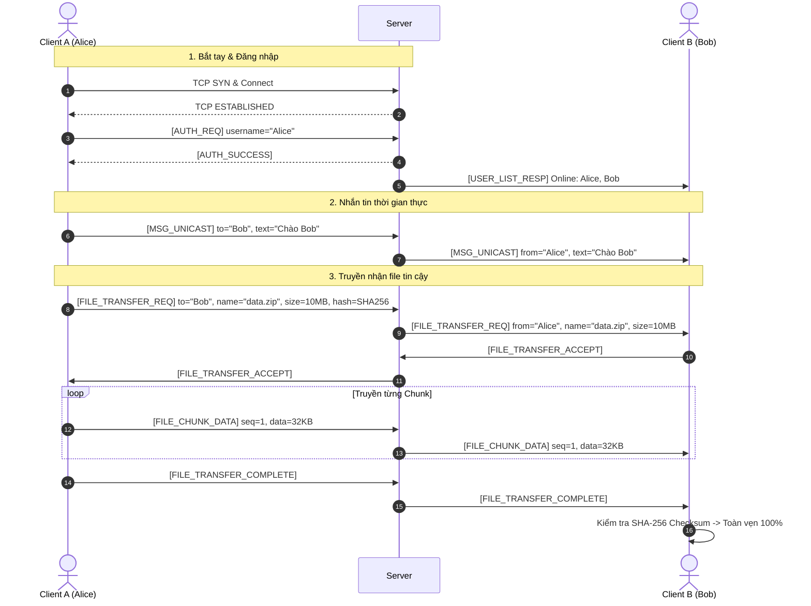
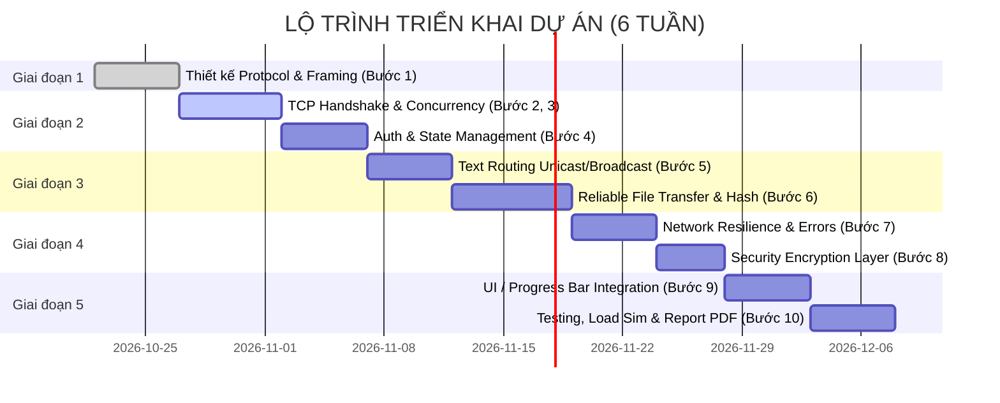

# KẾ HOẠCH CHI TIẾT & ĐẶC TẢ THỰC HIỆN BÀI TẬP LỚN
## DISTRIBUTED CLIENT-SERVER COLLABORATION APPLICATION
**Môn học:** Phát triển Ứng dụng Mạng (Network Application Development - MMT261)  
**Ngôn ngữ triển khai:** Python 3 (Sử dụng Raw Sockets)  
**Thời gian thực hiện đề xuất:** 6 tuần  

---

## MỤC LỤC
1. [Tổng quan & Mô tả bài toán](#1-tổng-quan--mô-tả-bài-toán)
2. [Thuật ngữ chuyên ngành cốt lõi](#2-thuật-ngữ-chuyên-ngành-cốt-lõi)
3. [Yêu cầu kỹ thuật & Ràng buộc nghiêm ngặt](#3-yêu-cầu-kỹ-thuật--ràng-buộc-nghiêm-ngặt)
4. [Cấu trúc mã nguồn & Chức năng từng file](#4-cấu-trúc-mã-nguồn--chức-năng-từng-file)
5. [Đặc tả giao thức tầng ứng dụng (Custom Application Protocol)](#5-đặc-tả-giao-thức-tầng-ứng-dụng-custom-application-protocol)
6. [Kế hoạch thực hiện theo 10 tiêu chí đánh giá (Rubric 10/10)](#6-kế-hoạch-thực-hiện-theo-10-tiêu-chí-đánh-giá-rubric-1010)
7. [Kết quả đầu ra mong đợi (Deliverables & Acceptance Criteria)](#7-kết-quả-đầu-ra-mong-đợi-deliverables--acceptance-criteria)

---

## 1. TỔNG QUAN & MÔ TẢ BÀI TOÁN

### 1.1. Bối cảnh & Động lực
Trong môi trường doanh nghiệp hiện đại, nhu cầu trao đổi thông tin và chia sẻ tệp theo thời gian thực giữa các nhóm phân tán là rất lớn. Các giải pháp thương mại phổ biến như Slack, Microsoft Teams, hay Google Drive đều lưu trữ và định tuyến dữ liệu qua các máy chủ đám mây công cộng bên thứ ba. Điều này tiềm ẩn các nguy cơ lớn về:
* Vi phạm quyền riêng tư và chính sách bảo mật nội bộ.
* Không hoạt động được trong môi trường mạng nội bộ cô lập (Air-gapped LAN) hoặc mất kết nối Internet.
* Tiêu tốn băng thông đường truyền quốc tế/ngoại mạng.

### 1.2. Mục tiêu dự án
Xây dựng một **Hệ thống Cộng tác Phân tán theo kiến trúc Client-Server** (Distributed Client-Server Collaboration Application) hoàn toàn tự lưu trữ (self-hosted), triển khai trên mạng LAN hoặc VPN. Ứng dụng cung cấp các dịch vụ cốt lõi:
1. **Quản lý phiên & Định danh người dùng (User Authentication & Discovery):** Đăng nhập, duy trì trạng thái kết nối, theo dõi danh sách thành viên trực tuyến theo thời gian thực.
2. **Nhắn tin thời gian thực (Real-Time Messaging):** Hỗ trợ trò chuyện kênh chung (Broadcast) và tin nhắn riêng tư trực tiếp 1-1 (Unicast).
3. **Truyền file tin cậy (Reliable File Transfer):** Truyền nhận tệp đa định dạng, kích thước lớn mà không xảy ra hư hỏng dữ liệu, có hiển thị thanh tiến trình (progress bar).
4. **Khả năng chịu lỗi kết nối (Connection Resilience):** Tự động phát hiện ngắt kết nối đột ngột, xử lý timeout, giải phóng tài nguyên socket an toàn và không gây sập máy chủ.
5. **Bảo mật dữ liệu (Security Layer):** Áp dụng mã hóa đối xứng cho toàn bộ payload dữ liệu truyền qua dây (over the wire), ngăn chặn kỹ thuật nghe lén mạng (packet sniffing).

---

## 2. THUẬT NGỮ CHUYÊN NGÀNH CỐT LÕI

Để hiểu rõ bản chất vấn đề và giải trình tự tin trong buổi bảo vệ (oral defense), các thuật ngữ sau được định nghĩa và làm rõ:

| Thuật ngữ | Khái niệm chi tiết & Ý nghĩa trong hệ thống |
| :--- | :--- |
| **Raw Socket (Socket nguyên bản)** | Giao diện lập trình mức thấp của hệ điều hành (dùng thư viện `socket` trong Python) cung cấp quyền truy cập trực tiếp vào tầng Transport (TCP/UDP) mà không qua bất kỳ lớp trung gian nào của tầng Application. |
| **Application Layer Protocol (Giao thức tầng ứng dụng)** | Bộ quy tắc và quy chuẩn cú pháp, ngữ nghĩa do chính lập trình viên thiết kế để quy định cách Client và Server đóng gói, gửi, nhận và thông dịch dữ liệu qua kênh truyền TCP/UDP. |
| **Stream-oriented Protocol (Giao thức định hướng dòng - TCP)** | TCP xem dữ liệu như một dòng byte liên tục (stream of bytes), không có khái niệm "ranh giới thông điệp" (message boundary). Nếu gửi 2 gói tin liên tiếp, bên nhận có thể đọc cả 2 gói cùng lúc hoặc chỉ một phần của gói đầu. |
| **Packet Sticking / Coalescing (Dính gói)** | Hiện tượng nhiều thông điệp riêng biệt được gửi đi liên tiếp bị gộp chung vào một bộ đệm nhận duy nhất tại tầng mạng hoặc tầng transport (do thuật toán Nagle của TCP). |
| **Packet Fragmentation (Phân mảnh gói)** | Hiện tượng một thông điệp có kích thước lớn bị tầng Transport/Network bẻ nhỏ thành nhiều phân đoạn (segments/packets) do giới hạn MTU, khiến bên nhận phải đọc nhiều lần mới đủ một thông điệp hoàn chỉnh. |
| **Length-Prefixed Framing (Đóng khung bằng tiền tố độ dài)** | Kỹ thuật giải quyết triệt để dính gói và phân mảnh trong TCP: Đặt một Header có kích thước cố định ở đầu mỗi gói tin, trong đó có một trường chứa độ dài chính xác của phần Payload phía sau. Phía nhận luôn đọc đủ kích thước Header, trích xuất độ dài `N`, sau đó lặp đọc chính xác `N` byte tiếp theo. |
| **Unicast (Truyền đơn điểm)** | Cơ chế truyền thông điệp từ 1 nguồn gửi trực tiếp đến 1 đích nhận duy nhất (ví dụ: Private Message giữa Alice và Bob). |
| **Broadcast (Truyền quảng bá)** | Cơ chế truyền thông điệp từ 1 nguồn gửi đến tất cả các máy trạm đang tham gia trong hệ thống (ví dụ: Tin nhắn phòng chat chung, thông báo User Online/Offline). |
| **File Chunking & Reassembly (Phân mảnh & Tái hợp tệp)** | Chia nhỏ file nhị phân có dung lượng lớn thành các khối byte có kích thước cố định (ví dụ 32KB hoặc 64KB/chunk), gán số thứ tự (Sequence Number), gửi tuần tự qua mạng và ghép lại chính xác ở phía nhận. |
| **Checksum / Data Integrity (Kiểm tra toàn vẹn)** | Sử dụng hàm băm mật mã (như SHA-256 hoặc MD5) để tạo ra mã đại diện cho dữ liệu gốc. Phía nhận tính lại mã này trên dữ liệu vừa nhận được để đối soát. Nếu khớp, chứng minh file truyền tải tin cậy 100% không bị suy hao hoặc biến đổi. |
| **Concurrency (Xử lý đồng thời)** | Khả năng máy chủ phục vụ đồng thời hàng chục Client kết nối mà không bị nghẽn (blocking). Triển khai qua mô hình **Multi-threading** (mỗi Client một luồng xử lý riêng) hoặc **I/O Multiplexing (select/selectors)**. |
| **Heartbeat / Keep-Alive** | Cơ chế gửi các gói tin định kỳ rỗng hoặc tín hiệu "ping-pong" giữa Client và Server để kiểm tra xem bên kia còn sống hay không. |
| **Half-Open Connection / Broken Pipe** | Tình trạng một đầu kết nối đã bị đóng (do mất mạng, rơi cáp, tắt đột ngột) nhưng đầu kia vẫn coi kết nối còn hiệu lực cho đến khi cố ghi dữ liệu vào socket và nhận ngoại lệ (`ConnectionResetError`, `BrokenPipeError`). |
| **Graceful Disconnect (Thoát êm)** | Quy trình đóng kết nối chuẩn mực: Client gửi thông điệp `LOGOUT` hoặc `DISCONNECT` báo trước cho Server, giải phóng socket, Server xóa thông tin phiên và cập nhật cho các client khác trước khi kết thúc luồng. |
| **Symmetric Encryption (Mã hóa đối xứng - AES)** | Phương pháp mã hóa sử dụng cùng một khóa bí mật (Secret Key) cho cả quá trình mã hóa (Encryption) và giải mã (Decryption), ví dụ thuật toán AES-128 hoặc AES-256 chế độ CBC/GCM, nhằm bảo vệ tính bí mật của payload. |

---

## 3. YÊU CẦU KỸ THUẬT & RÀNG BUỘC NGHIÊM NGẶT

1. **Tuyệt đối không dùng thư viện mạng bậc cao:**
   * Cấm: Flask, FastAPI, Django, Tornado, aiohttp.
   * Cấm: WebSockets, Socket.IO, gRPC, ZeroMQ.
   * Yêu cầu: Sử dụng thư viện tiêu chuẩn `import socket` và `import threading` (hoặc `import select`).
2. **Ngôn ngữ triển khai:** Python 3.10 trở lên.
3. **Môi trường hoạt động:** Chạy ổn định trên Windows, Linux và macOS sử dụng địa chỉ `127.0.0.1` (localhost) hoặc địa chỉ IP mạng nội bộ (LAN IP, ví dụ `192.168.x.x`).
4. **Khả năng mở rộng (Scalability):** Server phải chịu tải đồng thời tối thiểu **10 - 20 clients** cùng kết nối, nhắn tin và truyền file mà không gây deadlock hoặc crash server.
5. **Tính toàn vẹn mã nguồn:** Code tự viết, cấu trúc module hóa chuẩn mực, có chú thích giải thích rõ ràng để chuẩn bị cho buổi vấn đáp 100%.

---

## 4. CẤU TRÚC MÃ NGUỒN & CHỨC NĂNG TỪNG FILE

Dự án được tổ chức theo cấu trúc phân tầng rõ ràng (Layered Architecture), tách biệt giữa: **Tầng mạng (Network Logic)**, **Tầng giao thức & Xử lý dữ liệu (Protocol & Business Logic)** và **Tầng giao diện (User Interface)**.

```
d:/MyBachKhoa/MMT261/
│
├── docs/                                   # Tài liệu dự án
│   ├── Assignment 1 - Distributed...pdf     # Đề bài gốc
│   ├── plan.md                             # Bản kế hoạch chi tiết (File này)
│   ├── protocol_spec.md                    # Đặc tả chi tiết giao thức nhị phân
│   └── report_technical.md                 # Nội dung báo cáo kỹ thuật (chuyển PDF)
│
├── common/                                 # Module dùng chung cho cả Client & Server
│   ├── __init__.py
│   ├── constants.py                        # Các hằng số (Magic Bytes, Port, Buffer Size, Chunk Size)
│   ├── message_types.py                    # Enum định nghĩa các mã thông điệp (AUTH, CHAT, FILE...)
│   ├── protocol.py                         # Bộ đóng khung (Framing), Parser & Pack/Unpack gói tin
│   └── security.py                         # Module mã hóa/giải mã payload (AES-256-CBC hoặc Fernet)
│
├── server/                                 # Mã nguồn Server
│   ├── __init__.py
│   ├── server_main.py                      # Điểm khởi chạy Server (Entry point)
│   ├── core_server.py                      # Socket listener, chấp nhận kết nối TCP, đa luồng
│   ├── client_handler.py                   # Luồng riêng biệt xử lý yêu cầu của từng Client
│   ├── session_manager.py                  # Quản lý danh bạ Client online (User, IP, Port, Socket)
│   └── file_router.py                      # Quản lý và chuyển tiếp các luồng file giữa các Client
│
├── client/                                 # Mã nguồn Client
│   ├── __init__.py
│   ├── client_main.py                      # Điểm khởi chạy Client (Entry point)
│   ├── core_client.py                      # Socket client, quản lý kết nối gửi/nhận đến Server
│   ├── file_transfer.py                    # Xử lý chia chunk, tính SHA-256 và ghép file nhận được
│   └── ui/                                 # Giao diện người dùng
│       ├── __init__.py
│       ├── gui_app.py                      # Giao diện đồ họa trực quan (Tkinter / CustomTkinter)
│       └── cli_app.py                      # Giao diện dòng lệnh tương tác (Console tương tác)
│
├── tests/                                  # Kiểm thử tự động & Giả lập tải
│   ├── __init__.py
│   ├── test_protocol.py                    # Unit test đóng gói, giải gói và bảo toàn dữ liệu
│   ├── test_security.py                    # Unit test mã hóa và giải mã dữ liệu
│   └── simulate_load.py                    # Kịch bản giả lập 15-20 clients kết nối & chat đồng thời
│
├── requirements.txt                        # Danh sách thư viện phụ trợ (cryptography, v.v.)
└── README.md                               # Hướng dẫn cài đặt, cấu hình và chạy ứng dụng
```

### 4.1. Chi tiết chức năng từng file:

#### 📂 Thư mục `common/` (Cốt lõi giao thức & dùng chung)
* `constants.py`:
  * Khai báo các giá trị cố định toàn cục: `MAGIC_NUMBER = 0xAA55` (nhận diện gói tin hợp lệ), `HEADER_SIZE = 12` bytes, `DEFAULT_TCP_PORT = 8888`, `DEFAULT_UDP_PORT = 8889`, `CHUNK_SIZE = 32768` (32 KB/chunk), `ENCODING = 'utf-8'`.
* `message_types.py`:
  * Định nghĩa `Enum` cho tất cả các loại bản tin trong hệ thống:
    * `AUTH_REQ` (0x0001), `AUTH_SUCCESS` (0x0002), `AUTH_FAIL` (0x0003)
    * `USER_LIST_REQ` (0x0010), `USER_LIST_RESP` (0x0011)
    * `MSG_BROADCAST` (0x0020), `MSG_UNICAST` (0x0021)
    * `FILE_TRANSFER_REQ` (0x0030), `FILE_TRANSFER_ACCEPT` (0x0031), `FILE_TRANSFER_REJECT` (0x0032)
    * `FILE_CHUNK_DATA` (0x0033), `FILE_CHUNK_ACK` (0x0034), `FILE_TRANSFER_COMPLETE` (0x0035)
    * `HEARTBEAT_PING` (0x0090), `HEARTBEAT_PONG` (0x0091), `DISCONNECT_REQ` (0x00FF).
* `protocol.py`:
  * Chứa lớp `Packet` và các hàm `pack_message(msg_type, payload)` / `read_message(sock)`.
  * Hiện thực kỹ thuật **Length-Prefixed Framing**: Ghi/đọc đúng kích thước Header 12 bytes, lấy trường `payload_length`, sau đó dùng vòng lặp `recv()` cho đến khi nhận đủ chính xác độ dài byte payload. Ngăn ngừa 100% lỗi dính gói hoặc nhận thiếu gói.
* `security.py`:
  * Cung cấp các hàm `encrypt_payload(raw_bytes, key)` và `decrypt_payload(cipher_bytes, key)` sử dụng thư viện mật mã tiêu chuẩn (AES-256-CBC hoặc Fernet). Đảm bảo nếu dùng Wireshark bắt gói tin thì chỉ thấy dữ liệu rác đã được mã hóa.

#### 📂 Thư mục `server/` (Phần mềm máy chủ)
* `server_main.py`:
  * Điểm nhập (Entry point) khởi động Server. Phân tích tham số dòng lệnh (IP, Port) hoặc sử dụng mặc định, khởi tạo và duy trì vòng đời của `core_server`.
* `core_server.py`:
  * Khởi tạo TCP Server Socket (`socket.socket(AF_INET, SOCK_STREAM)`), thiết lập tùy chọn `SO_REUSEADDR`, lắng nghe kết nối (`bind`, `listen`).
  * Sử dụng vòng lặp chính `accept()`. Khi một Client kết nối, tạo một luồng riêng (`threading.Thread`) gắn với `ClientHandler` để xử lý song song không gây nghẽn.
* `client_handler.py`:
  * Quản lý trọn vẹn vòng đời kết nối của 1 Client cụ thể.
  * Lắng nghe gói tin đến thông qua `read_message()`.
  * Phân phối xử lý dựa trên `msg_type`: Xác thực danh tính, chuyển tiếp tin nhắn chat chung/riêng, báo hiệu gửi file.
  * Bắt các ngoại lệ mạng (`ConnectionResetError`, `TimeoutError`) để đóng kết nối an toàn (graceful cleanup) và thông báo cho các Client khác biết User đã thoát.
* `session_manager.py`:
  * Quản lý trạng thái chia sẻ (Thread-Safe với `threading.Lock`): Lưu trữ ánh xạ `username -> (socket, address, login_time)`.
  * Cung cấp các phương thức: `add_session()`, `remove_session()`, `get_all_online_users()`, `get_socket_by_username()`.
* `file_router.py`:
  * Điều phối quá trình trao đổi tệp giữa 2 Client: Chuyển tiếp yêu cầu xin gửi file, thông báo chấp nhận/từ chối, và định tuyến các khối dữ liệu (`FILE_CHUNK_DATA`) từ người gửi đến người nhận một cách thông suốt.

#### 📂 Thư mục `client/` (Phần mềm máy trạm)
* `client_main.py`:
  * Khởi động ứng dụng Client, cho phép người dùng chọn chế độ GUI hoặc CLI, nhập IP Server, Port và Tên hiển thị.
* `core_client.py`:
  * Quản lý kết nối TCP Socket đến Server.
  * Tách biệt 2 luồng công việc:
    1. **Luồng gửi:** Gửi yêu cầu đăng nhập, tin nhắn chat, lệnh xin gửi file do người dùng thao tác.
    2. **Luồng nhận (Background Listener Thread):** Liên tục lắng nghe và tiếp nhận thông điệp từ Server gửi xuống (tin nhắn mới, danh sách online thay đổi, file chunks...) để cập nhật lên giao diện.
* `file_transfer.py`:
  * Đảm nhiệm logic truyền file:
    * **Phía gửi:** Mở file nhị phân (`rb`), tính mã băm SHA-256 toàn thể, chia thành từng block 32KB, đánh số `chunk_id`, đóng gói và gửi qua mạng.
    * **Phía nhận:** Mở file tạm (`wb`), ghi tuần tự các chunks nhận được, tính toán phần trăm hoàn thành (cho Progress Bar), sau khi nhận đủ tiến hành so sánh SHA-256 để xác thực tính toàn vẹn trước khi đổi tên file chính thức.
* `ui/gui_app.py`:
  * Giao diện đồ họa hoàn chỉnh viết bằng **Tkinter** (hoặc **CustomTkinter**):
    * Cửa sổ đăng nhập trực quan.
    * Khung bên trái: Danh sách các Users đang online (cập nhật động).
    * Khung trung tâm: Cửa sổ hiển thị lịch sử chat chung (Broadcast) và các tab Chat riêng (Unicast).
    * Khung dưới: Hộp nhập văn bản, nút gửi tin, nút đính kèm gửi file.
    * Hộp thoại hiển thị thông báo nhận file và thanh tiến trình (Progress Bar) chạy mượt mà từ 0% đến 100%.
* `ui/cli_app.py`:
  * Giao diện Console dự phòng: Hỗ trợ các lệnh dạng `/list`, `/msg <user> <content>`, `/sendfile <user> <filepath>`, `/quit`.

#### 📂 Thư mục `tests/`
* `test_protocol.py`: Kiểm thử tự động đóng gói - giải mã dữ liệu, mô phỏng tình huống cắt đôi gói tin hoặc dính 2 gói tin liên tiếp để chứng minh thuật toán Framing hoạt động chuẩn 100%.
* `test_security.py`: Kiểm thử tính đúng đắn của giải thuật mã hóa/giải mã AES với các chuỗi ký tự đặc biệt, chuỗi rỗng và dữ liệu byte nhị phân.
* `simulate_load.py`: Script tự động spawn 15-20 Client kết nối đồng thời vào Server, thực hiện gửi nhận tin nhắn ngẫu nhiên để kiểm chứng khả năng chịu tải và không bị nghẽn mạch (đáp ứng tiêu chí Scalability).

---

## 5. ĐẶC TẢ GIAO THỨC TẦNG ỨNG DỤNG (CUSTOM APPLICATION PROTOCOL)

Hệ thống áp dụng mô hình đóng khung gói tin nhị phân chuẩn (Custom Binary Header + Encrypted Payload):

```
 0                   1                   2                   3
 0 1 2 3 4 5 6 7 8 9 0 1 2 3 4 5 6 7 8 9 0 1 2 3 4 5 6 7 8 9 0 1
+-+-+-+-+-+-+-+-+-+-+-+-+-+-+-+-+-+-+-+-+-+-+-+-+-+-+-+-+-+-+-+-+
|       MAGIC (2 Bytes)         |       VERSION (1B)    |FLAGS(1)|
+-+-+-+-+-+-+-+-+-+-+-+-+-+-+-+-+-+-+-+-+-+-+-+-+-+-+-+-+-+-+-+-+
|       MSG TYPE (2 Bytes)      |          RESERVED (2 Bytes)   |
+-+-+-+-+-+-+-+-+-+-+-+-+-+-+-+-+-+-+-+-+-+-+-+-+-+-+-+-+-+-+-+-+
|                     PAYLOAD LENGTH (4 Bytes)                  |
+-+-+-+-+-+-+-+-+-+-+-+-+-+-+-+-+-+-+-+-+-+-+-+-+-+-+-+-+-+-+-+-+
|                                                               |
|                   PAYLOAD DATA (Mã hóa AES)                   |
|                   (Độ dài: PAYLOAD LENGTH bytes)              |
|                                                               |
+-+-+-+-+-+-+-+-+-+-+-+-+-+-+-+-+-+-+-+-+-+-+-+-+-+-+-+-+-+-+-+-+
```

### 5.1. Cấu trúc trường Header (Kích thước cố định 12 Bytes):
1. **Magic Bytes (2B):** Giá trị `0xAA55`. Dùng để kiểm tra tính hợp lệ của gói tin, chống việc đọc phải rác mạng.
2. **Version (1B):** `0x01` (Phiên bản 1.0 của giao thức).
3. **Flags (1B):** `0x01` (Encrypted), `0x00` (Plaintext), `0x02` (Compressed).
4. **Message Type (2B):** Mã định danh loại thông điệp (xem bảng enum ở trên).
5. **Reserved (2B):** Dự phòng cho việc mở rộng sau này (`0x0000`).
6. **Payload Length (4B - Big Endian uint32):** Kích thước chính xác của khối dữ liệu Payload theo sau. Tối đa 4GB.

### 5.2. Luồng giao tiếp cốt lõi (Sequence Flow):



---

## 6. KẾ HOẠCH THỰC HIỆN THEO 10 TIÊU CHÍ ĐÁNH GIÁ (RUBRIC 10/10)

Kế hoạch được chia thành **5 giai đoạn chiến lược** nhằm hiện thực hóa hoàn hảo 10 tiêu chí trong tài liệu BTL:



### Giai đoạn 1: Thiết kế giao thức & Khung nền tảng (Rubric Step 1 - 1 pt)
* **Mục tiêu:** Định nghĩa chuẩn hóa cấu trúc gói tin, mã lệnh và luồng dữ liệu trước khi viết code nghiệp vụ.
* **Nhiệm vụ cụ thể:**
  1. Viết file `common/constants.py` và `common/message_types.py`.
  2. Viết file `common/protocol.py` chứa thuật toán Length-Prefixed Pack & Unpack với `struct.pack("!HBBHI...", ...)`.
  3. Viết unit test `tests/test_protocol.py` để chứng minh giải thuật chống dính gói/phân mảnh hoạt động hoàn hảo.
* **Kết quả:** Bộ thư viện đóng/giải gói tin hoạt động độc lập và đạt chuẩn.

### Giai đoạn 2: Lõi mạng Server & Xử lý đồng thời (Rubric Step 2, 3, 4 - 3 pts)
* **Mục tiêu:** Server lắng nghe, chấp nhận nhiều Client cùng lúc, đăng nhập và quản lý danh sách online.
* **Nhiệm vụ cụ thể:**
  1. **Step 2 (Handshake):** Tạo `server/core_server.py` với socket TCP. Client kết nối, trao đổi gói tin chào hỏi và nhận ACK thành công.
  2. **Step 3 (Concurrency):** Triển khai mô hình Multi-threading (`threading.Thread` cho mỗi client) trong `server/client_handler.py`. Đảm bảo hàng chục client kết nối/ngắt kết nối cùng lúc mà không xung đột tài nguyên.
  3. **Step 4 (Authentication & State):** Xây dựng `server/session_manager.py` với cơ chế khóa `threading.Lock`. Lưu trữ bảng người dùng: Tên đăng nhập, địa chỉ IP, cổng (port) và thời gian đăng nhập. Cập nhật và phát danh sách online cho tất cả thành viên khi có người vào/ra.
* **Kết quả:** Hệ thống Server-Client đa luồng, hỗ trợ đăng nhập và đồng bộ danh sách online ổn định.

### Giai đoạn 3: Nghiệp vụ Nhắn tin & Truyền File tin cậy (Rubric Step 5, 6 - 2 pts)
* **Mục tiêu:** Định tuyến tin nhắn (broadcast/unicast) và truyền file kích thước lớn an toàn.
* **Nhiệm vụ cụ thể:**
  1. **Step 5 (Real-Time Routing):** Hiện thực logic phân luồng tin nhắn:
     * Nếu là `MSG_BROADCAST`: Server lặp qua danh bạ session và chuyển tiếp cho tất cả các Client (ngoại trừ người gửi).
     * Nếu là `MSG_UNICAST`: Server tra cứu socket của người nhận đích trong `session_manager` và đẩy tin nhắn đến đúng người đó.
  2. **Step 6 (Reliable File Transfer):** Hiện thực `client/file_transfer.py` và `server/file_router.py`:
     * Bước xin phép: Gửi tên file, kích thước file, mã băm SHA-256. Phía nhận xác nhận chấp thuận.
     * Bước chia mảnh: Đọc file theo từng chunk 32KB, đánh số `seq_id`, gửi tuần tự.
     * Bước tái hợp: Bên nhận ghi từng chunk vào file `.part`, ráp đủ thì kiểm tra hash SHA-256 so với ban đầu. Nếu trùng khớp mới lưu thành file hoàn chỉnh.
* **Kết quả:** Nhắn tin tức thời mượt mà; gửi nhận file (PDF, hình ảnh, video, zip) không bao giờ bị lỗi dữ liệu (Zero Corruption).

### Giai đoạn 4: Chống chịu lỗi mạng & Lớp bảo mật (Rubric Step 7, 8 - 2 pts)
* **Mục tiêu:** Hệ thống bền bỉ trước sự cố mạng và mã hóa bảo mật toàn bộ dữ liệu.
* **Nhiệm vụ cụ thể:**
  1. **Step 7 (Network Resilience):** 
     * Bọc tất cả các thao tác `recv()` và `send()` trong khối `try/except (ConnectionResetError, ConnectionAbortedError, BrokenPipeError, socket.timeout)`.
     * Khi Client ngắt kết nối đột ngột (tắt ngang terminal, rút dây mạng), Server tự động phát hiện, đóng socket, xóa khỏi `session_manager`, thông báo cho các client khác mà không bị crash.
     * Cài đặt cơ chế Heartbeat định kỳ kiểm tra kết nối sống.
  2. **Step 8 (Security Layer):**
     * Hoàn thiện `common/security.py` sử dụng thư viện `cryptography` với thuật toán AES-256.
     * Toàn bộ payload trước khi gửi qua `socket.sendall()` đều được mã hóa, bên nhận nhận xong mới giải mã.
* **Kết quả:** Server chạy liên tục không sập trước mọi tình huống tắt client; dữ liệu truyền trên mạng an toàn tuyệt đối trước Wireshark.

### Giai đoạn 5: Giao diện trực quan, Kiểm thử & Đóng gói Báo cáo (Rubric Step 9, 10 - 2 pts)
* **Mục tiêu:** Giao diện thân thiện, kiểm thử tải nhiều terminal và chuẩn bị tài liệu nộp bài.
* **Nhiệm vụ cụ thể:**
  1. **Step 9 (UI Integration):**
     * Hoàn thiện giao diện Tkinter tại `client/ui/gui_app.py`.
     * Tích hợp: Danh sách user online dạng danh sách chọn, tab chat riêng biệt, thanh tiến trình `Progress Bar` cập nhật phần trăm truyền tải file thực tế.
  2. **Step 10 (Testing & Code Quality):**
     * Chạy script `tests/simulate_load.py` kích hoạt đồng thời 15-20 client ảo, gửi tin nhắn liên tục để thẩm định độ bền.
     * Chuẩn hóa mã nguồn theo chuẩn PEP8, bổ sung docstrings và chú thích chi tiết cho từng hàm.
  3. **Biên soạn Báo cáo Kỹ thuật (Technical Report PDF):**
     * Vẽ sơ đồ kiến trúc hệ thống (System Architecture Diagram).
     * Bảng đặc tả chi tiết giao thức (Protocol Specification Table).
     * Sơ đồ tuần tự (Sequence Diagrams) cho luồng gửi tin và truyền file.
     * Viết bài luận 1 trang phân tích các thách thức: Xử lý dính gói (Framing), xử lý đồng thời (Thread Safety & Race Conditions), xử lý mất kết nối (Dead sockets) và giải pháp giải quyết.
* **Kết quả:** Bộ mã nguồn hoàn chỉnh 100%, tài liệu hướng dẫn và báo cáo PDF sẵn sàng nộp bài.

---

## 7. KẾT QUẢ ĐẦU RA MONG ĐỢI (DELIVERABLES & ACCEPTANCE CRITERIA)

Dựa trên yêu cầu mục 10 của đề bài, sản phẩm bàn giao cuối cùng bao gồm:

### 7.1. Mã nguồn hoàn chỉnh (Source Code Deliverable)
1. **Toàn bộ Scripts Server & Client:** Đầy đủ các module như đã thiết kế trong mục 4, không thiếu sót.
2. **File `README.md` chất lượng cao:**
   * Hướng dẫn môi trường: Phiên bản Python yêu cầu, lệnh cài đặt thư viện (`pip install -r requirements.txt`).
   * Lệnh khởi chạy Server: Ví dụ `python -m server.server_main --port 8888`.
   * Lệnh khởi chạy các Client: Ví dụ `python -m client.client_main --host 127.0.0.1 --port 8888`.
   * Hướng dẫn sử dụng tính năng Chat (Broadcast, Unicast) và File Transfer.

### 7.2. Báo cáo giải thích kỹ thuật (Technical Explanation Report - PDF)
Bao gồm 4 cấu phần bắt buộc:
1. **System Architecture:** Sơ đồ tương tác giữa các thành phần Client và Server.
2. **Protocol Specification:** Đặc tả chi tiết từng byte của Header, các trường cờ (flags) và cấu trúc payload của từng mã loại thông điệp.
3. **Sequence Diagrams:** Sơ đồ thời gian biểu diễn:
   * Vòng đời kết nối và gửi tin nhắn (Connection, Auth, Message routing).
   * Vòng đời xin gửi, chia chunk, xác thực hash SHA-256 của truyền file.
4. **Challenges & Solutions (1 trang phản ánh học thuật):**
   * *Thách thức 1:* Xử lý phân mảnh và dính gói trong TCP Stream -> *Giải pháp:* Thiết kế Fixed Header + Length-Prefixed Framing.
   * *Thách thức 2:* Tranh chấp tài nguyên trong môi trường đa luồng (Race Condition) -> *Giải pháp:* Quản trị danh bạ Client bằng Mutex Lock (`threading.Lock`).
   * *Thách thức 3:* Đảm bảo tính toàn vẹn của tệp truyền tải -> *Giải pháp:* Chia nhỏ chunk, đánh số thứ tự tuần tự và đối soát mã băm SHA-256.

### 7.3. Tiêu chí nghiệm thu (Checklist Đạt 10/10 Điểm)
* [x] **Step 1 (1 pt):** Có tài liệu đặc tả giao thức rõ ràng với đầy đủ Header và Type (`AUTH`, `MSG`, `FILE`...).
* [x] **Step 2 (1 pt):** Client kết nối TCP thành công đến Server và trao đổi bắt tay ban đầu.
* [x] **Step 3 (1 pt):** Server xử lý đa luồng, hỗ trợ cùng lúc > 10 kết nối mà không block.
* [x] **Step 4 (1 pt):** Đăng nhập có định danh, Server theo dõi và phát danh sách online kèm IP:Port.
* [x] **Step 5 (1 pt):** Gửi được tin nhắn kênh chung (Broadcast) và tin nhắn riêng đến từng người (Unicast).
* [x] **Step 6 (1 pt):** Truyền được tệp bất kỳ kích thước lớn bằng cơ chế chia chunk, ghép lại kiểm tra mã băm nguyên vẹn.
* [x] **Step 7 (1 pt):** Đóng hoặc ngắt kết nối đột ngột một Client bất kỳ thì Server vẫn chạy bình thường, giải phóng phiên sạch sẽ.
* [x] **Step 8 (1 pt):** Payload dữ liệu được mã hóa bằng thuật toán tiêu chuẩn (AES), soi Wireshark không thấy plain text.
* [x] **Step 9 (1 pt):** Giao diện người dùng trực quan, có danh sách online và thanh tiến trình truyền file (Progress Bar).
* [x] **Step 10 (1 pt):** Code sạch chuẩn PEP8, có tài liệu README đầy đủ và vượt qua bài test giả lập nhiều client.
